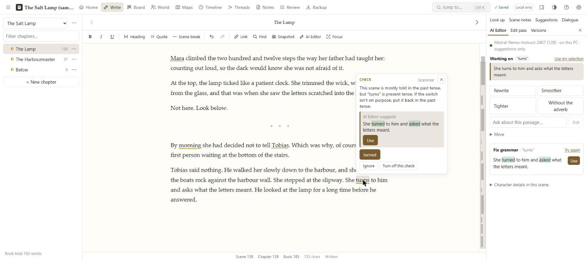
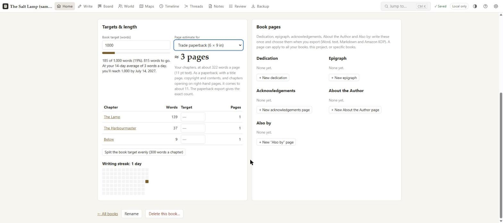
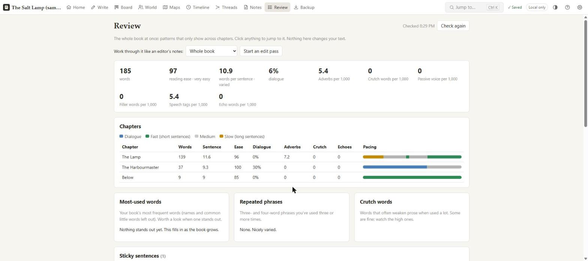
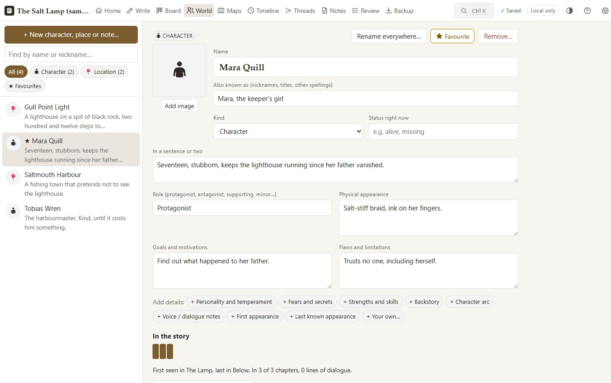
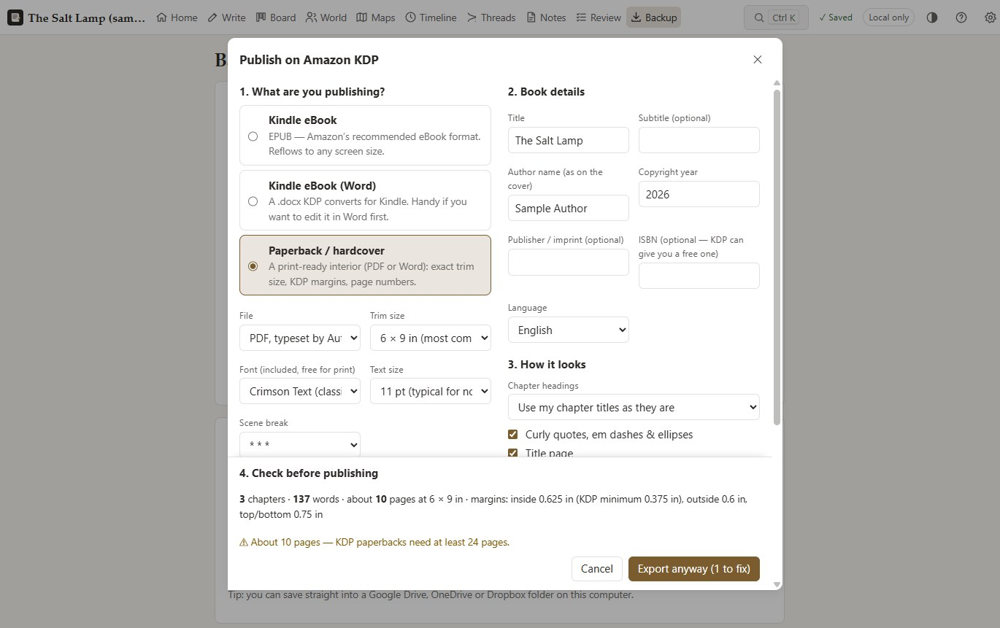
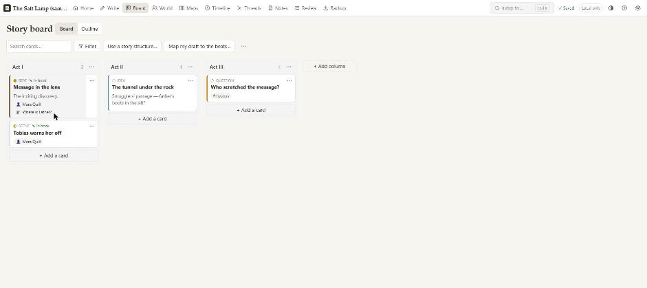

# AuthorDesk: novel-writing software with a grammar checker and AI editor

**AuthorDesk is a free writing app for novelists that runs entirely on your own computer, on Windows and Linux.** Write your book, keep a series bible of characters and places, plan the plot with story structures, check grammar and style as you type, get rewrites from a private AI editor, and export a print-ready KDP paperback PDF or EPUB, all in one window and without sending your writing anywhere.

**[⬇ Download the latest version for Windows or Linux](https://github.com/toxiicxmonster/AuthorDesk/releases/latest)** · [User guide](docs/user-guide.md) · [What's new](https://github.com/toxiicxmonster/AuthorDesk/releases)



- **Your writing stays on your computer.** No account, no cloud, no subscription, no analytics. Your writing never leaves your computer unless you turn on sync, Google Drive or the online grammar check yourself.
- **A grammar checker and AI editor that run offline.** LanguageTool and an open-source AI model (llama.cpp) run on your own computer: no limits, no monthly fee, and your manuscript never trains anyone's model.
- **Built for fiction.** It knows your characters' names, catches tense slips, echo words and continuity slips, reviews pacing chapter by chapter, and keeps the details of every book in a series straight.
- **You own your data.** Automatic backups are ordinary zip files with plain JSON inside; export to Word, Markdown, text, JSON, EPUB, PDF and CSV at any time.

## Why AuthorDesk?

Novelists usually piece together a writing app (like Scrivener), a style checker (like ProWritingAid or Grammarly) and a formatting tool (like Vellum or Atticus), with subscriptions and cloud uploads along the way. AuthorDesk does the core of all three in one private app:

| You want to… | AuthorDesk gives you |
| --- | --- |
| Draft and organise a novel | Chapters and scenes, a story board, timeline, plot threads, and a character and world bible |
| Catch mistakes and weak prose | Live grammar, spelling and style underlines, tense slips, echo words, hard-to-read sentences, adverbs with stronger verbs |
| Improve a passage | A private AI editor: rewrite, tighten, smooth, clearer, show-don't-tell, tone, and a character's voice, with one-click **Use** |
| See the whole book | Readability, pacing, overused words, sticky sentences, continuity, characters who drop out, and edit passes |
| Publish | A KDP paperback interior PDF typeset for you, Kindle EPUB 3, and Word |

## Screenshots

All taken with the sample book that comes with the app.

| | |
| --- | --- |
|  |  |
| **Targets & length:** progress, a finish-by date and printed page estimates | **Review:** the whole book at once, chapter by chapter |
|  |  |
| **Characters & world:** the series bible every check knows about | **Publish on Amazon KDP:** a typeset paperback PDF or EPUB, with a pre-publish check |
|  | |
| **Story board:** plan with cards and story structures | |

> **Version 0.11.1.** Features are covered by automated tests and checked in the running app; see [Project status](#project-status).

---

## Contents

- [Install (download a release)](#install-download-a-release)
- [What it does](#what-it-does)
- [Building from source](#building-from-source)
- [How the desktop app works](#how-the-desktop-app-works)
- [Where your data lives and backups](#where-your-data-lives-and-backups)
- [Bringing in an existing book](#bringing-in-an-existing-book)
- [Publishing on Amazon KDP](#publishing-on-amazon-kdp)
- [Optional: sync between computer and phone](#optional-sync-between-computer-and-phone)
- [Optional: Google Drive backups](#optional-google-drive-backups)
- [Development](#development)
- [Project layout](#project-layout)
- [Privacy and security](#privacy-and-security)
- [Project status](#project-status)
- [Known limitations](#known-limitations)
- [Documentation](#documentation)
- [License](#license)

---

## Install (download a release)

AuthorDesk is a desktop app for **Windows and Linux**. It has its own built-in browser engine, so it doesn't need Edge, Chrome or anything else installed, and you don't need Node or any developer tools to use it. Get the latest version from the [**Releases**](../../releases) page.

**Windows 10 or 11**

1. Download `AuthorDesk-v<version>-windows.zip` and unzip it somewhere permanent, such as `C:\Users\<you>\AuthorDesk`. Keep the files together.
2. Double-click **AuthorDesk.exe**. **File → Add a desktop shortcut** (or **Add to the Start menu**) makes it easy to find next time.
3. Windows may show "Windows protected your PC" because the app isn't code-signed. Click **More info → Run anyway**, or [build it yourself](#building-from-source).

**Linux (64-bit)**

- **AppImage** (any distribution): download `AuthorDesk-v<version>-linux-x86_64.AppImage`, make it executable (`chmod +x AuthorDesk-*.AppImage`, or *Properties → Allow executing*) and run it. **File → Add to the applications menu** adds it to your launcher. Some distributions need `libfuse2` for AppImages.
- **Debian, Ubuntu and derivatives:** download `authordesk_<version>_amd64.deb` and install it with `sudo apt install ./authordesk_<version>_amd64.deb`. It appears in your applications menu.

**Coming from an earlier version (0.8 or older)?** The earlier Windows version kept your books inside a private Edge or Chrome profile. The first time the new AuthorDesk starts, it copies them into its own storage and leaves the original untouched. If that copy can't be read, the welcome screen offers to restore each book from your automatic backups instead. An earlier copy that updates itself lands on the new app automatically.

**Updating:** automatic for the Windows folder and the AppImage. AuthorDesk checks for a new release in the background, downloads it, and asks whether to restart now or install it when you close AuthorDesk. The `.deb` tells you when a new version is out. (Windows copies on 0.9 to 0.10.1 can't install updates by themselves: download 0.10.2 or newer once and unzip it over the old folder.) Your books are not stored with the app (see [Where your data lives](#where-your-data-lives-and-backups)), so updates never touch them. To turn updates off, put an empty file named `no-auto-update.txt` next to the app or in the data folder.

**Add-ons:** on first launch AuthorDesk offers to install the private grammar engine and AI Editor in the background, and keeps them updated when a release pins newer versions (about 17 GB, with a free-space check; *Not now* and *Don't ask again* are there too, and **Settings → Add-ons** installs them later).

- **Private AI Editor (optional):** rewrites, tightens and smooths passages in a side panel, judges adverbs in context and keeps character notes up to date, using llama.cpp and an open-source model on your computer (NVIDIA, AMD and Intel graphics, or the processor). Nothing goes into your book until you click **Use** on a version you like.
- **Private grammar engine (recommended):** LanguageTool with English usage data, on your computer, with no limits and nothing sent anywhere.

---

## What it does

| Area | What you get |
| --- | --- |
| **Getting started** | Welcome screen with a ready-made sample book, a **Ctrl+K** quick switcher to jump to any chapter, character, note or command, click-to-rename titles, a labelled toolbar, one-time tips, a Help panel (**F1**), and a Trash instead of permanent deletes. |
| **Themes** | Paper, Sepia, Pastel Blue, Sage, Cozy Cottage and Night, plus *Match my device*. Make your own from five colours with a live preview and a readability check, and share themes as files. Quick theme menu (◐) in the top bar. |
| **Manuscript editor** | Book → (Part) → Chapter → Scene. Bold, italic, underline, headings, block quotes and scene breaks. Autosave with a visible status, undo/redo, word counts (selection, scene, chapter, book), a **pacing strip** beside the page (sentence lengths, dialogue and narration, click to jump), focus mode, find & replace in a scene or **across the whole book** (rename a character everywhere, with a preview of every change and one-click undo), clean paste from Word and Google Docs, automatic and manual snapshots with restore, split and merge scenes. |
| **Targets and length** | **Writing sprints** (15, 25 or 45 minutes, with the words you wrote and your rate), a book word target with a finish-by date at your recent pace, chapter targets with progress bars, a writing-streak calendar, and **estimated printed pages** for the book and every chapter (only the pages you've actually written) at mass-market, KDP paperback and hardcover sizes or as a standard manuscript. |
| **Navigation** | Chapter list with a filter (titles and text), pinned and recent chapters, drag-and-drop or menu-based reordering, moving scenes between chapters, tidying chapter titles (removing typed-in numbers), keyboard shortcuts for next and previous scene or chapter, and a collapsible drawer on phones. |
| **Characters and world (series bible)** | Characters, locations, factions, species, items, lore, glossary and research entries with templated and custom fields, aliases, tags, favourites, images and relationships. Duplicate warnings, "Mentioned in" backlinks, a quick-reference side panel while you write, and each character's **arc** across the book (where they appear, and when they drop out). |
| **Series** | Several books sharing one character and world bible, where each entry appears book by book, continuity checked across books, and bringing an existing project into a series. |
| **Maps** | A relationship map you can arrange (the AI Editor can suggest relationships from your notes, quoting where each comes from), a family tree drawn from relationships, and pictures of places with pins and the scenes set there. |
| **Story board and plot structures** | Lanes and cards (drag-and-drop or an accessible move menu), filters, and story structures (three-act, Save the Cat, Hero's Journey, seven-point, blank or your own) whose beats say what they do and where they fall. **Map my draft to the beats** suggests the scene for each beat. Turn cards into scenes or chapters and back; an outline view with inline summaries, and AI scene and chapter summaries. |
| **Timeline and plot threads** | Timeline in story-world order or chapter order, with gentle continuity hints. A plot-thread grid showing which chapters each thread appears in, with reminders for threads that have gone quiet. |
| **Proofreading** | **Live underlines as you write**, like Grammarly or Google Docs. On your device: Hunspell spelling (US or UK), grammar and punctuation rules, commonly confused words and idioms, repeated words, dialogue punctuation, name consistency against your character list (catches swapped letters like "Elsei"), and optional style fixes (cut or replace adverbs and filler words). Every underline offers something to change the text to; notes without a concrete fix are never shown. **Deep grammar check** with [LanguageTool](https://languagetool.org): install the private grammar engine (**Settings → Add-ons**) and AuthorDesk runs it on your computer with English usage data, with no limits and nothing sent anywhere; or opt in to the free online service or your own server. Accept, Ignore, Add to dictionary or turn a check off, with undo and reviewed bulk fixes. **Tense slips** (narration drifting between past and present), **echo words**, **continuity** (a character described differently in different chapters, or an age that doesn't fit the timeline), **hard-to-read sentences**, stronger verbs for verb + adverb pairs, and character details your notes are missing. **It never changes your text on its own.** |
| **AI Editor (private)** | Runs an open-source model on your computer with llama.cpp. Rewrite, smoother, tighter, without the adverb, without the echo, clearer, fix grammar, show don't tell, change tone, what's the tone, character voice, and ask. Clicking a flagged word shows its best fix right there. It can also tell you whether a changed detail looks like a continuity mistake or a deliberate change, and explain a chapter's main patterns like an editor's note. Every version has **Use** (one undoable step); nothing is written into your book otherwise. |
| **Review the whole book** | Reading ease, sentence variety, dialogue share, pacing per chapter, overused words and phrases, crutch words, sticky sentences, slow stretches, continuity, and **character voices** (who talks, how much, their usual speech tags and the words that set each voice apart). **Edit passes** turn every suggestion into a checklist to work through, and export as a report for a human editor. |
| **Search** | Search everything (Ctrl+K): manuscript, references, board, timeline, threads and notes, with filters and snippets. Opening a result highlights the matches. |
| **Import your existing book** | A folder or zip of chapter files (`.md` or `.txt`) plus spreadsheets for characters, locations, world entries, story board, timeline and plot threads. You see a preview before anything is imported, and entries are linked by name. Exact layout: [**IMPORTING.md**](IMPORTING.md). |
| **Book pages** | Dedication, epigraph, acknowledgements, About the Author and "Also by", written once on the **Home** page. Each one can apply to all your books, every book in the project, or specific books, and you choose which to include in every export (Word, text, Markdown, KDP). |
| **Pitch** | The book's **logline, back-cover blurb and synopsis** on Home, with an optional first draft from the AI Editor built from your chapter summaries and outline notes (it points out any name it made up). The blurb can become the eBook's description. |
| **Publish on Amazon KDP** | Kindle eBook as **EPUB 3** (Amazon's recommended format, in a Classic, Modern or Minimal style) or **Word**, and a **paperback/hardcover interior**: a print-ready **PDF typeset by AuthorDesk** (two bundled book fonts, running heads, real page numbers in the contents, no stranded lines) or `.docx`, at KDP trim sizes. Mirrored margins meet KDP's gutter rules, chapters start on right-hand pages, front and back matter are added, and an optional **table of contents** is included. A pre-publish checklist catches common problems. |
| **Backup and export** | **Automatic backups** to a folder you choose (a OneDrive or Google Drive folder works), with sensible retention, plus an optional **second copy** on a USB drive or cloud folder. A complete `.authorproj` archive (manifest, schema version, SHA-256 checksums), and import with a preview: restore, merge, or import as a copy. Also exports to DOCX, TXT, Markdown, JSON and references CSV. |
| **Sync (optional)** | A self-hosted sync server you run yourself. Independent edits merge automatically. If both devices change the same prose, both versions are kept and you choose between them side by side. |
| **Google Drive (optional)** | Back up to and restore from your own Drive using the narrow `drive.file` permission. |

A full walk-through is in the [**user guide**](docs/user-guide.md).

### Keyboard shortcuts

| Keys | Action |
| --- | --- |
| Ctrl+K / Ctrl+Shift+F | Search or jump to anything |
| Ctrl+F | Find & replace in the scene |
| Ctrl+Shift+H | Find & replace in the whole book |
| Ctrl+S | Save now |
| Alt+PageDown / PageUp | Next / previous chapter |
| Alt+Shift+PageDown / PageUp | Next / previous scene |
| Ctrl+Alt+F | Focus mode (Esc exits) |
| Ctrl+\\ | Show or hide the chapter list |
| F1 or ? | Help |
| Ctrl+= / Ctrl+- / Ctrl+0 | Zoom in / out / reset |
| F11 | Full screen |

---

## Building from source

### What you need

| Tool | Why | Get it |
| --- | --- | --- |
| **Windows 10/11 or Linux** | Each builds its own version (the Linux packages are also built on GitHub Actions). | n/a |
| **Node.js 22.5 or newer** | Builds the web app and desktop app, and runs the tests and the sync server. | [nodejs.org](https://nodejs.org/) (LTS) |
| **Git** | Cloning the repository. | [git-scm.com](https://git-scm.com/) |

### Build and run

```bash
git clone https://github.com/toxiicxmonster/AuthorDesk.git
cd AuthorDesk/app
npm install
npm test
npm run build            # the web app, into app/dist
cd ../desktop
npm install
npm test
npm start                # runs the desktop app from the source folder
```

### Packaging

```bash
cd desktop
npm run dist:win && node scripts/package-windows.cjs   # Windows: releases/AuthorDesk-v<version>-windows.zip
npm run dist:linux                                      # Linux: releases/desktop/*.AppImage and *.deb
```

The [Desktop (Linux)](.github/workflows/desktop.yml) workflow builds the AppImage and `.deb` on Ubuntu, starts both, installs the `.deb`, and checks the add-on installers on Linux. It runs for every release tag.

To publish: bump `version` in `desktop/package.json` and `app/package.json`, package, then create a GitHub release tagged `v<version>` with the Windows zip, the AppImage and the `.deb` attached. Installed copies pick it up in the background; each updates from the asset whose name ends in `-windows.zip` or `-linux-x86_64.AppImage`.

Icons: `desktop/build/icon.ico` and `icon.png` are committed. To regenerate them and the PWA icons in `app/public`, run `scripts/make-icons.ps1` on Windows.

---

## How the desktop app works

The desktop app (`desktop/`) is an [Electron](https://www.electronjs.org/) shell around the same web app.

- It serves the built app on **`http://localhost:47820`** and answers requests from this computer only (loopback). Nothing on your network can reach it.
- It shows the app in its own window with Electron's built-in Chromium engine, with its own storage under the AuthorDesk data folder (`%LOCALAPPDATA%\AuthorDesk` on Windows, `~/.local/share/AuthorDesk` on Linux). It never touches your everyday browser.
- Starting it a second time brings up the existing window. Closing the window quits it and stops the add-ons.
- It starts the add-ons when they're needed: the grammar engine at launch, the AI Editor on first use (unloaded after 15 minutes idle, since it holds several GB of graphics memory). Their installers (`desktop/src/installers.cjs`) check each download against a published SHA-256.
- If a `sync-server.txt` file is present, it forwards `/api/*` requests to that sync server. Only HTTPS addresses (or loopback) are accepted. See [sync](#optional-sync-between-computer-and-phone).
- Links to websites open in your normal browser.

---

## Where your data lives and backups

Your books are stored in the app's own database (IndexedDB), in the AuthorDesk data folder: `%LOCALAPPDATA%\AuthorDesk\App` on Windows, `~/.local/share/AuthorDesk/App` on Linux. **File → Open data folder** opens it.

- **Automatic backups** go to `Documents/AuthorDesk Backups` (or a folder you choose under **Backup → Automatic backups**), one folder per book, outside the app's storage.
- **Back up regularly:** go to **Backup → Save backup** for a complete `.authorproj` archive, and keep copies off this computer (a USB drive or a cloud folder). AuthorDesk reminds you when a backup is overdue.
- **To restore:** go to **Backup → Restore an AuthorDesk backup** (or **Restore a backup** on the welcome screen), choose the archive, review the preview, then choose **Restore**, **Merge** or **Import as a copy**.
- Archives are zip files with plain JSON inside (`data/*.json`), so your work is never locked in.
- Every scene keeps revision snapshots automatically; see the **Versions** tab in the side panel of the writing view.

---

## Bringing in an existing book

Go to **Backup → Import**, or choose **Bring in my existing book** on the welcome screen.

```
My Book/
├── chapters/
│   ├── 01 - The Lamp.md        ← one file per chapter (.md or .txt); "## " starts a new scene
│   └── 02 - Below.txt
├── characters.csv              ← or characters/<Name>.md, one file each
├── locations.csv
├── world.csv                   ← factions, items, lore… with a Type column
├── board.csv
├── timeline.csv
├── plot-threads.csv
└── notes/
```

Every column, accepted file type and naming rule is documented in [**IMPORTING.md**](IMPORTING.md). A filled-in example is in [`docs/import-template/`](docs/import-template/), and you can download it from inside the app.

Word `.docx` files can't be imported directly. Save chapters from Word as `.txt`, or download Google Docs as Markdown.

---

## Publishing on Amazon KDP

Go to **Backup → Publish on Amazon KDP…**, or press Ctrl+K and type *Publish*.

| Format | Use it for |
| --- | --- |
| **Kindle eBook (EPUB)** | Recommended for Kindle. EPUB 3 with navigation, landmarks, NCX and an optional cover. |
| **Kindle eBook (Word)** | A `.docx` with Heading 1 chapters, as KDP expects. |
| **Paperback / hardcover** | A print-ready interior at your chosen KDP trim size: a **PDF typeset by AuthorDesk** (recommended; two bundled book fonts) or a `.docx` to adjust in Word. |

The print interior gets:
- mirrored margins sized to KDP's gutter rules for your page count
- page numbers, left off chapter-opening pages
- chapters starting on right-hand pages
- title, copyright, dedication, epigraph, acknowledgements, about-the-author and "also by" pages
- curly quotes and em dashes (applied to the exported copy only)

The **table of contents** is optional. In eBooks its entries link to each chapter. In print it is either a chapter list or one with dot leaders and page numbers. The typeset PDF has real page numbers already; in the Word file they're filled in by Microsoft Word, so open it in Word, click **Yes** to update fields, and save before uploading.

Chapters with no text yet are left out (the rest are numbered without a gap). The pre-publish checklist warns about missing author details, leftover "TK"/"TODO" notes, planning bullets still in a chapter, and books outside KDP's 24–828 print-page limits. Book details (author, ISBN, imprint…) are saved with the book; dedication, epigraph, acknowledgements, About the Author and "Also by" pages come from **Book pages** on Home.

Upload the file as the **manuscript** on KDP's Content page. Check print interiors in KDP's **Print Previewer** (same trim size, *No bleed*) and eBooks in **Kindle Previewer**. Covers are uploaded separately.

---

## Optional: sync between computer and phone

Sync is off unless you set it up, and it uses **your own** server; there is no AuthorDesk cloud.

1. Run the sync server (`server/`, Node 22.5+, no npm dependencies, SQLite built in) somewhere both devices can reach **over HTTPS**. [Tailscale](https://tailscale.com/) on your own computer is the simplest private option.
2. Create an account, open the server's address on your phone and install the app (*Add to Home screen*).
3. On the computer, copy `sync-server.example.txt` to `sync-server.txt` in the AuthorDesk data folder (**File → Open data folder**) and put the server's HTTPS address in it, then restart AuthorDesk. It forwards sync requests there.

Full instructions: [`docs/sync-server.md`](docs/sync-server.md).

How it behaves:
- Each record is versioned.
- Independent edits on two devices merge automatically.
- If both devices change the same prose, **both versions are kept** and a side-by-side resolver lets you choose.
- An edit wins over a delete, so nothing is silently lost.

---

## Optional: Google Drive backups

Release builds **don't include a Google client ID**, so the Drive buttons say Drive isn't set up. To turn Drive on, build from source:

1. Create an OAuth client ID ("Web application") in Google Cloud by following [`docs/google-drive-setup.md`](docs/google-drive-setup.md).
2. Copy `app/.env.example` to `app/.env.local` and set `VITE_GOOGLE_CLIENT_ID`. A client ID is a public identifier, not a secret, and AuthorDesk has no client secret.
3. Rebuild (see [Building from source](#building-from-source)).

AuthorDesk asks only for the `drive.file` permission, so it can see only the files it creates. The access token is kept in memory and never stored.

Until you've set that up, point **Automatic backups** at a Google Drive for Desktop folder, or **Save backup** straight into one.

---

## Development

```bash
cd app
npm install
npm run dev          # http://localhost:5173 (a separate data origin from the desktop app)
npm test             # unit + integration tests (vitest, fake IndexedDB, in-memory sync server)
npm run typecheck
npm run lint
npm run build        # production build into app/dist
```

```bash
cd server
node index.js        # sync server; see server/.env.example and docs/sync-server.md
```

**Stack:**

| Part | Built with |
| --- | --- |
| Web app | React 19, TypeScript, Vite 8, TipTap 3 (ProseMirror), Dexie 4 (IndexedDB), zod 4, vite-plugin-pwa (Workbox), fflate, docx |
| Spell check | nspell with Hunspell en-US and en-GB dictionaries, in a Web Worker |
| Desktop app | Electron 44 (Windows and Linux), electron-builder |
| Sync server | Node with `node:sqlite` |
| Tests | vitest with jsdom and fake-indexeddb |

Design notes are in [`docs/architecture.md`](docs/architecture.md) and the ADRs in [`docs/adr/`](docs/adr/).

---

## Project layout

```
app/                React + TypeScript + Vite PWA
  src/domain/         schemas (zod), text utilities, references, continuity, templates
  src/storage/        IndexedDB (Dexie), repository, search, backlinks, migrations
  src/editor/         TipTap editor, proofreading and find extensions, autosave
  src/proofreading/   provider interface, deterministic rules, Hunspell worker
  src/importExport/   archive, exporters, import, EPUB / KDP Word, Google Drive
  src/sync/           merge rules, sync engine, controller and status
  src/ui/             pages and components
  tests/              vitest suites
server/             self-hostable sync server (Node, no dependencies, SQLite)
desktop/            desktop app (Electron): window, local server, add-on installers, backups, updater
scripts/            make-icons.ps1
docs/               user guide, architecture, ADRs, setup guides, import template, screenshots
.github/workflows/  Linux build and checks
PROJECT.md          product specification
IMPLEMENTATION_PLAN.md  phase-by-phase status
IMPORTING.md        exact import layout
```

`app/dist`, `releases/`, `node_modules`, `.env*` files, `sync-server.txt`, databases, backups and exports are git-ignored. Build the app as above or download it from Releases.

---

## Privacy and security

- **No analytics or tracking.** Proofreading runs entirely on your device. The only connections AuthorDesk makes on its own are a check for new versions on GitHub and, when you install add-ons, their downloads (from GitHub, Hugging Face, languagetool.org and Eclipse Adoptium), each checked against a published checksum or exact size.
- **No manuscript text is ever sent anywhere** unless you turn on sync, Drive or the online grammar check. Sync and Drive go only to your own server or your own Drive. The online check sends only the paragraphs of the scene you're editing, and only after you agree to an explanation of exactly what is sent (Settings → Proofreading).
- **AuthorDesk never silently changes your prose.** Every proofreading change is your click, and it can be undone.
- **No secrets** in the app bundle or this repository. `.env`, `sync-server.txt`, databases and backups are git-ignored.
- **The desktop app's local server answers only loopback requests.**
- **The sync server** requires a login and uses:
  - HttpOnly, SameSite=Strict session cookies
  - an anti-CSRF header
  - rate-limited login attempts
  - scrypt-hashed passphrases
  - logs that never include request bodies
- **Don't host AuthorDesk with your data on GitHub Pages.** Static hosting is public. This repository is for source code only, so never commit manuscripts or backups to it.

---

## Project status

| Area | Status |
| --- | --- |
| Writing, navigation, references, planning, proofreading, search, archives, import, themes | ✅ Done and tested |
| AI Editor, grammar engine, review and edit passes, series, maps, automatic backups | ✅ Done, tested, and checked in the running app |
| Desktop app | ✅ Windows: built and checked on a real PC (books moved over from 0.8, add-ons, editor). Linux: AppImage and `.deb` built, started and checked automatically on Ubuntu 24.04, with the add-on installers; not yet tried by hand on a Linux desktop |
| Amazon KDP export | 🟡 Done and tested; files checked (PDF pages rendered, EPUB structure, Word layout); needs a real KDP upload and an EPUBCheck run |
| Sync | 🟡 Done and tested with simulated devices and a local phone test; needs an HTTPS deployment and a real phone install |
| Google Drive | 🟡 Built; needs a real account round-trip test |
| Accessibility | 🟡 Automated audit (axe-core) of every main page in the desktop app: no issues; readable contrast in every theme. A hands-on screen-reader test is not done yet |
| Android PWA install test, deployed-server security review | ⬜ Not yet done |

Details: [IMPLEMENTATION_PLAN.md](IMPLEMENTATION_PLAN.md).

---

## Known limitations

- Spell check covers US and UK English. The on-device grammar checks are rule-based hints, not a full parser; turn on the optional LanguageTool check for deeper grammar. The free LanguageTool service allows about 20 checks a minute, so after a large paste the rest of the scene is checked a little later.
- Google Drive is untested with a real account. There's no folder picker: backups go to an "AuthorDesk Backups" folder that AuthorDesk creates.
- Sync: deleting a project on one device doesn't delete it on others; use *Delete cloud copy*. Revision snapshots stay on each device.
- Word `.docx` files can't be imported directly (see [IMPORTING.md](IMPORTING.md)).
- Windows and 64-bit Linux only for now (no macOS build).
- The Windows app isn't code-signed, so Windows SmartScreen warns on first launch.

---

## Documentation

| Document | What's in it |
| --- | --- |
| [docs/user-guide.md](docs/user-guide.md) | How to use every part of the app |
| [IMPORTING.md](IMPORTING.md) | Exact folder and spreadsheet layout for importing a book |
| [docs/sync-server.md](docs/sync-server.md) | Running your own sync server |
| [docs/google-drive-setup.md](docs/google-drive-setup.md) | Setting up Google Drive backups |
| [docs/architecture.md](docs/architecture.md) | How the app is put together |
| [docs/adr/](docs/adr/) | Architecture decision records |
| [PROJECT.md](PROJECT.md) | Product specification |
| [IMPLEMENTATION_PLAN.md](IMPLEMENTATION_PLAN.md) | Phase-by-phase status |

---

## License

AuthorDesk is free software under the [GNU General Public License v3](LICENSE). You may use, study, share and change it; if you distribute a changed version, it must stay under the same license with its source available.
